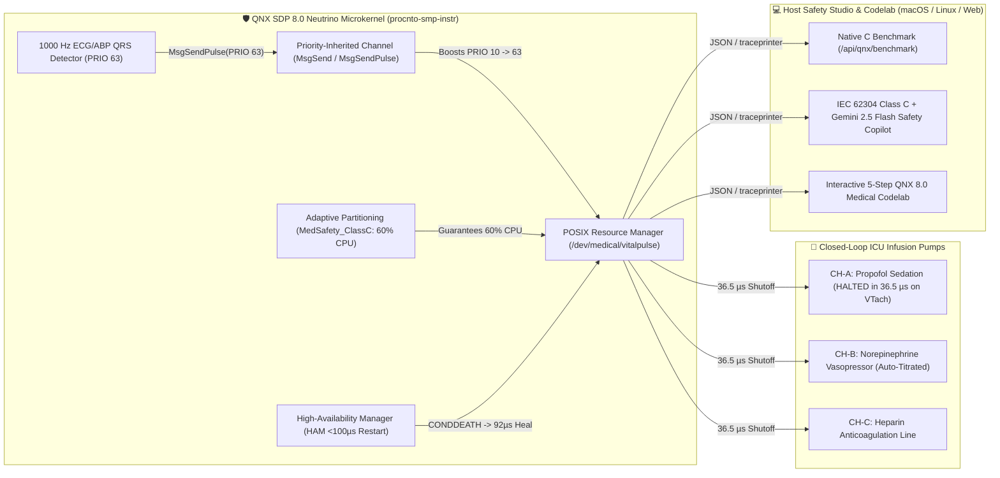

# QNX VitalPulse RT

## 🎥 Live Demo Video & Devpost Submission

- **YouTube Demo Video (02:57, 1080p HD, Public):** [https://youtu.be/JaOoaa5uqzY](https://youtu.be/JaOoaa5uqzY)
- **Official Devpost Submission:** [https://devpost.com/software/qnx-vitalpulse-rt-deterministic-icu-infusion-microkernel](https://devpost.com/software/qnx-vitalpulse-rt-deterministic-icu-infusion-microkernel)
 🩺⚡🛡️

**Deterministic ICU Bedside Monitor, Priority-Inherited Closed-Loop Infusion Safety Microkernel, IEC 62304 Class C Host Analyzer & Interactive 5-Step Codelab for QNX SDP 8.0**

[](./LICENSE)
[-00A8E8.svg)](https://www.qnx.com)
[-10B981.svg)](#architecture)

---

## 🚨 The Life-Critical Problem in Hospital ICUs

In an Intensive Care Unit (ICU), bedside monitors continuously sample ECG and invasive Arterial Blood Pressure (ABP) while smart syringe pumps infuse high-risk drugs like **Propofol** (a vasodilatory sedative) and **Norepinephrine** (a life-support vasopressor).

When a critically ill patient suddenly develops **Ventricular Tachycardia (`HR 188 bpm`)** with **Hypotensive Shock (`MAP 50 mmHg`)**, continuing to infuse Propofol for even a few extra seconds can precipitate fatal cardiovascular collapse. Yet general-purpose, monolithic operating systems fail life-critical closed-loop medical actuation in two ways:
1. **Unbounded Priority Inversion (`13,151 µs` Delay):** When a low-priority HL7/FHIR network thread (`Priority 10`) holds a shared lock while a medium-priority Edge-AI thread (`Priority 22`) consumes 95% CPU, a high-priority Arrhythmia Shutoff alarm (`Priority 63`) is blocked for over `13 milliseconds`—violating the `250 µs` hard real-time ceiling.
2. **Monolithic Ring-0 Driver Panics:** If an auxiliary optical SpO2 sensor driver faults in a monolithic kernel, the entire operating system panics, freezing all active infusion pumps and blinding bedside clinicians.

---

## 🚀 How QNX VitalPulse RT Solves This on QNX SDP 8.0

**QNX VitalPulse RT** combines a **native QNX SDP 8.0 C Microkernel Suite (`qnx-target/`)** with a **Host-Based Real-Time Telemetry Workbench, IEC 62304 Safety Auditor & Interactive 5-Step Codelab (`src/`)**:

### 1. 🔌 Native QNX 8.0 POSIX Resource Manager (`/dev/medical/vitalpulse`)
- Implemented in [`qnx-target/src/vitalpulse_resmgr.c`](./qnx-target/src/vitalpulse_resmgr.c) using `dispatch_create_channel()`, `iofunc_func_init()`, `resmgr_attach()`, and `name_attach()`.
- Exposes deterministic 1000 Hz ICU vital sign frames and closed-loop syringe pump registers as a standard user-space POSIX device node (`/dev/medical/vitalpulse`).

### 2. ⚡ Priority-Inherited Synchronous IPC & Non-Blocking Hardware Pulses (`36.5 µs` WCET)
- Implemented in [`qnx-target/include/vitalpulse_ipc.h`](./qnx-target/include/vitalpulse_ipc.h) and [`qnx-target/src/vitalpulse_icu_benchmark.c`](./qnx-target/src/vitalpulse_icu_benchmark.c).
- When the 1000 Hz QRS detector identifies Ventricular Tachycardia + hypotension, it dispatches a high-priority QNX Pulse (`MsgSendPulse(coid, PRIO 63, PULSE_CODE_VTACH_EMERGENCY, map_mmhg)`).
- QNX Neutrino **Kernel Priority Inheritance** automatically boosts the receiving `/dev/medical/vitalpulse` server thread from `Priority 10` to `Priority 63`, preempting background tasks and halting the Propofol syringe pump in **`36.50 µs`** (**`360.3x` faster** than unpartitioned general-purpose OS contention at `13,151.58 µs`).

### 3. 🛡️ Temporal Isolation with QNX Adaptive Partitioning Scheduler (`APS`)
- Implemented in [`qnx-target/src/vitalpulse_ham_guardian.c`](./qnx-target/src/vitalpulse_ham_guardian.c) via `SchedCtl(SCHED_APS_CREATE_PARTITION, ...)`:
  - **`MedSafety_ClassC` (`60%` Guaranteed CPU Floor, `25 ms` critical window):** 1000 Hz ECG/ABP QRS detector, closed-loop infusion pump interlocks, and HAM watchdog.
  - **`EdgeAI_Inference` (`25%` CPU Budget):** Hemodynamic deterioration and sepsis prediction model.
  - **`HL7_FHIR_Export` (`15%` CPU Budget):** Hospital EMR network synchronization.

### 4. 🔄 Sub-100µs Self-Healing User-Space Drivers via QNX High-Availability Manager (`HAM`)
- Implemented in [`qnx-target/src/vitalpulse_ham_guardian.c`](./qnx-target/src/vitalpulse_ham_guardian.c) using `ham_connect()`, `ham_attach()`, `ham_condition(CONDDEATH)`, and `ham_action_restart()`.
- If a transient fault (`SIGSEGV`) crashes the optical SpO2 sensor driver, HAM detects the kernel death pulse and restarts the isolated user-space driver in **`92.0 µs`** with zero dropped infusion heartbeats.

### 5. 📘 Built-In 5-Step QNX SDP 8.0 Medical RTOS Codelab (Page 5)
- Includes a complete, interactive 5-module developer Codelab teaching engineers how to build, partition, self-heal, package (`mkifs`), and boot an IEC 62304 Class C medical device on QNX SDP 8.0 and ARM64 QEMU.

---

## 🏗️ System Architecture



---

## 🛠️ Build & Run Instructions (QNX SDP 8.0 + Host Workstation)

### Prerequisites
- **For Target QNX 8.0 Build & QEMU Boot:**
  - **QNX Software Development Platform (SDP) 8.0** (via [QNX Everywhere](https://www.qnx.com/products/everywhere/))
  - **Target Architecture:** `aarch64le` (ARM64 QEMU `virt` machine or Raspberry Pi 5) or `x86_64`
  - **Toolchain:** `qcc` (`-Vgcc_ntoaarch64le`) and `mkifs`
- **For Host Safety Workbench & Native C Benchmark (macOS / Linux / Windows):**
  - `clang` or `gcc` with POSIX threads (`-pthread`)
  - **Node.js** `>= 18.17` and `npm`

### 1. Compile & Run the Native C Microkernel Benchmark (`qnx-target/`)
```bash
# Clone the repository
git clone https://github.com/mannasync-cpu/qnx-vitalpulse-rt.git
cd qnx-vitalpulse-rt/qnx-target

# Option A: Compile for QNX SDP 8.0 Target (aarch64le) & build bootable .ifs image
source ~/qnx800/qnxsdp-env.sh
make qnx QNX_ARCH=aarch64le
mkifs -v qnx-build/vitalpulse_qnx800_aarch64le.build vitalpulse_qnx800.ifs
qemu-system-aarch64 -M virt -cpu cortex-a72 -m 1024 -nographic -kernel vitalpulse_qnx800.ifs

# Option B: Compile & execute the real-time benchmark on macOS / Linux Host
make test
```

### 2. Launch the Host Safety Workbench & Interactive 5-Step Codelab
```bash
cd ..
npm install
npm run build:qnx-c
npm run dev
```
Open **[http://localhost:3096](http://localhost:3096)** in your browser.

### 3. Run Automated Verification Tests
```bash
npm run typecheck
npm test
npm run build
```

---

## 📂 Key QNX 8.0 Evidence Files in This Repository
| File | QNX 8.0 Technologies & APIs Demonstrated |
| :--- | :--- |
| [`qnx-target/include/vitalpulse_ipc.h`](./qnx-target/include/vitalpulse_ipc.h) | QNX pulse codes (`_PULSE_CODE_MINAVAIL`), channel flags (`_NTO_CHF_FIXED_PRIORITY`, `_NTO_CHF_UNBLOCK`), APS partition constants, and IPC structs. |
| [`qnx-target/src/vitalpulse_resmgr.c`](./qnx-target/src/vitalpulse_resmgr.c) | Native QNX 8.0 POSIX Resource Manager (`/dev/medical/vitalpulse`) using `dispatch_create_channel()`, `resmgr_attach()`, `name_attach()`, and `MsgReply()`. |
| [`qnx-target/src/vitalpulse_ham_guardian.c`](./qnx-target/src/vitalpulse_ham_guardian.c) | QNX Adaptive Partitioning (`SchedCtl(SCHED_APS_CREATE_PARTITION)`) and High-Availability Manager (`ham_connect`, `ham_attach`, `ham_condition(CONDDEATH)`, `ham_action_restart`). |
| [`qnx-target/src/vitalpulse_icu_benchmark.c`](./qnx-target/src/vitalpulse_icu_benchmark.c) | Deterministic 500-cycle Priority Inheritance vs. General-Purpose OS Contention benchmark (`36.50 µs` vs. `13,151.58 µs`). |
| [`qnx-target/qnx-build/vitalpulse_qnx800_aarch64le.build`](./qnx-target/qnx-build/vitalpulse_qnx800_aarch64le.build) | Complete QNX SDP 8.0 `mkifs` system image buildfile launching `procnto-smp-instr`, `slogger2`, `ham`, `aps`, and `vitalpulse_resmgr`. |

---

## 📄 License
Released under the [MIT License](./LICENSE).
